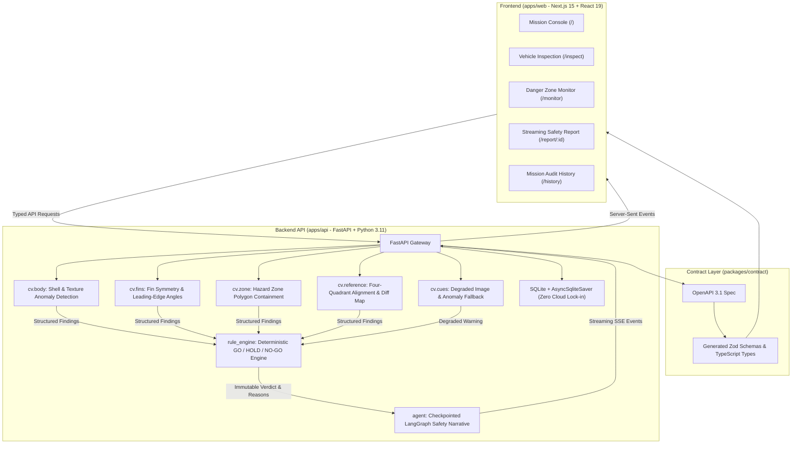

# LaunchGuard AI

> **Decision-support tool. Not a replacement for certified range safety.**

LaunchGuard AI is an automated range safety co-pilot engineered for low-cost, amateur, academic, and private rocket launch operations. It combines computer vision, deterministic safety rules, and agentic LLM briefing to inspect launch vehicles and verify launchpad hazard zones prior to flight operations.

---

## Architectural Principle: Vision Proposes, Rules Decide, Agent Explains

LaunchGuard AI strictly enforces an isolated safety boundary to guarantee predictable, un-hallucinated decisions:

- **Computer Vision Proposes**: OpenCV algorithms and YOLOv8 models analyze imagery to extract geometric metrics (fin angles, crack contours, zone intrusions, motion).
- **Rule Engine Decides**: An isolated, pure-function Python rule engine ([`rule_engine`](file:///D:/Works/hackathon%20KYS/apps/api/rule_engine/verdict.py#L1)) evaluates all findings against configured thresholds and returns a deterministic **GO**, **HOLD**, or **NO-GO** verdict. The language model has zero authority over verdicts and has no schema field to alter them.
- **Agent Explains**: A LangGraph workflow ([`agent`](file:///D:/Works/hackathon%20KYS/apps/api/agent/graph.py#L1)) ingests the deterministic findings to synthesize an executive safety briefing, prioritized remediation actions, and hedged uncertainty summaries.



---

## Core Capabilities

### 1. Pre-Launch Optical Hardware Inspection
- **Fin Alignment & Symmetry**: Detects fin contour edges and computes leading-edge angle deviations in degrees (calibrated threshold: warning at > 3.0 deg, critical at > 6.0 deg, with a documented +/- 1.5 deg measurement tolerance).
- **Fuselage Defect Scanning**: Analyzes rocket surface texture, detecting fracture lines, burns, and foreign attachments.
- **Geometric Sanity Guard**: Automatically validates vehicle aspect ratio and rocket-like geometry; unverified or non-rocket uploads yield a degraded warning rather than false detections.

### 2. Four-Quadrant Golden Reference Inspection
- **Multi-Angle Coverage**: Ingests baseline reference imagery across four standard quadrants (Front 0 deg, Right 90 deg, Back 180 deg, Left 270 deg).
- **Surface Deviation Heatmaps**: Aligns current flight vehicle captures to baseline references using ECC homography and edge structural comparison, isolating newly introduced fractures or damage.
- **Interactive Diff Viewer**: An interactive split-screen slider allows safety officers to inspect baseline vs. current captures with red difference contour overlays.

### 3. Dynamic Launchpad Hazard Zone Monitoring
- **Real-Time Polygon Exclusion**: Safety officers can plot custom exclusion zones over the pad webcam or surveillance feed.
- **YOLOv8 Detection**: Automatically identifies personnel, service vehicles, and foreign objects within the designated hazard perimeter.
- **Containment Breach Alerts**: Intrusions trigger immediate critical findings, locking the launch verdict to NO-GO until the exclusion zone is verified clear.

### 4. Environmental & Meteorological Verification
- Ingests wind speed (m/s), visibility (good / poor), precipitation (none / light / heavy), and officer area clearance.
- Evaluates atmospheric safety envelopes against NFPA 1122/1127 amateur rocketry guidelines.

### 5. Checkpointed Safety Briefings & SSE Streaming
- **Live Event Pipeline**: Server-Sent Events (SSE) stream checklist verification steps, metric evaluations, and AI briefing generation in real time.
- **Crash Recovery**: Built on LangGraph `AsyncSqliteSaver`, interrupted inspection runs automatically recover their checkpoint state without data loss upon server restart.
- **Hedged Uncertainty Copy**: Language model output strictly employs non-definitive, hedged syntax ("appears", "suggests", "possible") to prevent unwarranted confidence.

---

## Repository Structure

```text
.
├── apps/
│   ├── api/                     # FastAPI backend application
│   │   ├── agent/               # LangGraph workflow, state, tools, and narrative generation
│   │   ├── app/                 # FastAPI routers, lifespan, schemas, SSE events, and recovery
│   │   ├── cv/                  # OpenCV algorithms (body, fins, zone, reference diff, YOLOv8)
│   │   ├── db/                  # SQLAlchemy async SQLite models, repo, and migrations
│   │   ├── rule_engine/         # Pure deterministic verdict rules (zero AI dependencies)
│   │   └── tests/               # Unit, contract, and end-to-end integration test suites
│   └── web/                     # Next.js 15 App Router web interface
│       ├── app/                 # App Router pages (/, /inspect, /monitor, /report, /history)
│       ├── components/          # UI components (Radix primitives, Tailwind CSS v4, Motion)
│       ├── hooks/               # Stream consumer (SSE) and webcam acquisition hooks
│       ├── lib/                 # Contract schemas, SSE client, and upload utilities
│       └── tests/               # Vitest component, a11y, and contract boundary tests
├── packages/
│   └── contract/                # Generated TypeScript types and Zod schemas from OpenAPI 3.1
├── scripts/                     # OpenAPI export, fixture generation, and dev orchestration
├── specs/                       # Architectural specifications, data models, and feature plans
├── .env.example                 # Root environment variable documentation
└── package.json                 # Monorepo workspace configuration (pnpm)
```

---

## Technologies

| Subsystem | Technology | Purpose |
| :--- | :--- | :--- |
| **Frontend Framework** | [Next.js 15](https://nextjs.org/) (App Router, Turbopack) | Server-rendered UI and SSE-safe reverse proxy |
| **UI Library** | [React 19](https://react.dev/) + [Tailwind CSS v4](https://tailwindcss.com/) | Range safety operator dashboard |
| **Animation & Motion** | [Motion](https://motion.dev/) | Subtle status transitions and visual feedbacks |
| **Component Primitives**| [Radix UI](https://www.radix-ui.com/) | Accessible dialogs, tabs, progress, and tooltips |
| **Backend Framework** | [FastAPI](https://fastapi.tiangolo.com/) + [Uvicorn](https://www.uvicorn.org/) | Async API gateway with single-worker execution |
| **Computer Vision** | [OpenCV](https://opencv.org/) (Headless) + [NumPy](https://numpy.org/) | Edge detection, homography alignment, texture analysis |
| **Object Detection** | [Ultralytics YOLOv8](https://github.com/ultralytics/ultralytics) | Pad personnel and vehicle danger zone intrusion |
| **Agentic Workflow** | [LangGraph](https://github.com/langchain-ai/langgraph) | Checkpointed, fault-tolerant safety narrative agent |
| **Database** | [SQLAlchemy 2](https://www.sqlalchemy.org/) + [aiosqlite](https://github.com/omnilib/aiosqlite) | Async SQLite relational storage and state persistence |
| **Contract Synchronization** | [Hey-API OpenAPI-TS](https://github.com/hey-api/openapi-ts) | Code-generated types and Zod schemas |
| **Package Manager** | [pnpm](https://pnpm.io/) | Monorepo dependency management |

---

## Quickstart & Local Development

### Prerequisites
- **Node.js**: Version 22.0.0 or higher
- **pnpm**: Version 12.0.0 or higher (`corepack enable && corepack prepare pnpm@latest --activate`)
- **Python**: Version 3.11 or higher (3.11.x - 3.12.x supported)

---

### Step 1: Install Dependencies & Setup Environment

```bash
# 1. Clone the repository
git clone <repository-url>
cd "hackathon KYS"

# 2. Install workspace JavaScript/TypeScript dependencies
pnpm install

# 3. Create and activate a Python virtual environment
cd apps/api
python -m venv .venv

# On Windows (PowerShell):
.venv\Scripts\Activate.ps1
# On Linux / macOS:
# source .venv/bin/activate

# 4. Install backend dependencies in editable mode
pip install --upgrade pip
pip install -e ".[dev]"

# 5. Return to root and generate TypeScript contract types from OpenAPI
cd ../..
pnpm generate
```

---

### Step 2: Environment Configuration

Create a `.env` file in `apps/api/.env` (or copy from [`apps/api/.env.example`](file:///D:/Works/hackathon%20KYS/apps/api/.env.example)):

```ini
# apps/api/.env
OPENAI_API_KEY=sk-...               # Optional: needed for AI safety summaries
OPENAI_MODEL=gpt-4o-mini            # Model used for explanations
DATABASE_URL=sqlite+aiosqlite:///./launchguard.db
CHECKPOINT_DB=./checkpoints.db
MEDIA_ROOT=./media
CORS_ORIGINS=http://localhost:3000
LOG_LEVEL=INFO
OPENAI_TIMEOUT_S=6.0
```

---

### Step 3: Run the Application

Launch the backend and frontend in separate terminals:

```bash
# Terminal 1: Backend API (from apps/api directory)
# Note: --workers 1 is REQUIRED for SSE streaming and SQLite checkpointer consistency
cd apps/api
uvicorn app.main:app --reload --port 8000 --workers 1

# Terminal 2: Web Frontend (from repository root)
pnpm --filter @launchguard/web dev
```

Navigate to `http://localhost:3000` to access the LaunchGuard Mission Console.

---

## Verification & Testing Suite

All tests can be executed locally to ensure contract integrity and safety compliance:

```bash
# Backend Test Suite (93 unit & contract tests)
cd apps/api
pytest tests/unit -v

# Backend Static Typechecking & Linting (strict mode)
mypy --strict app cv agent rule_engine db
ruff check .
cd ../..

# Frontend Typecheck & Linting
pnpm --filter @launchguard/web typecheck
pnpm --filter @launchguard/web lint

# Frontend Test Suite (49 Vitest unit, contract, and a11y tests)
pnpm --filter @launchguard/web test

# Browser End-to-End Regression Tests (with API and Web running)
pnpm exec playwright test
```

---

## Production Deployment

LaunchGuard AI is designed with an SSE-safe reverse proxy embedded inside Next.js ([`apps/web/app/api/[...path]/route.ts`](file:///D:/Works/hackathon%20KYS/apps/web/app/api/%5B...path%5D/route.ts#L1)). All browser requests talk directly to Next.js on `/api/*`, which proxies them to the backend API.

### Option 1: Hybrid Cloud (Vercel + Render / Railway)

- **Frontend on Vercel**: Connect your repository, set the Root Directory to `apps/web`, and provide the environment variable:
  - `API_URL`: `https://your-backend-api.onrender.com`
- **Backend on Render / Railway**: Deploy `apps/api` with Python 3.11.
  - **Start Command**: `uvicorn app.main:app --host 0.0.0.0 --port $PORT --workers 1`
  - **Storage**: Attach a Persistent Disk mounted to `/var/data` to ensure SQLite databases and uploaded reference photos survive redeployments.
  - **Environment Variables**:
    - `DATABASE_URL`: `sqlite+aiosqlite:////var/data/launchguard.db`
    - `CHECKPOINT_DB`: `/var/data/checkpoints.db`
    - `MEDIA_ROOT`: `/var/data/media`
    - `CORS_ORIGINS`: `https://your-frontend.vercel.app`
    - `OPENAI_API_KEY`: Your key

### Option 2: Linux VPS with Docker Compose

Deploying to a single Ubuntu VPS (e.g. DigitalOcean, Hetzner, AWS EC2) behind Caddy or Nginx keeps all traffic local and eliminates cross-origin latency:

```bash
# Run multi-container stack with persistent volumes
docker compose up -d --build
```

---

## Safety Boundaries & Honest Limitations

1. **Decision Support Only**: LaunchGuard AI is engineered as an operational co-pilot for rocketry teams. It does not replace certified range safety officers or official aviation and launch authorization authorities.
2. **Fail-Safe Degraded Operation**: Any computer vision processing error, timeout, or confidence score below `0.35` produces a degraded `warning` rather than an `ok`. Missing mandatory checklist items force at least a `HOLD`.
3. **Optical Sensitivity**: Geometric measurements (fin angles, crack detection) depend upon camera perspective, resolution, and adequate lighting. Fin angles carry a documented uncertainty of +/- 1.5 degrees.
4. **Meteorological Sensors**: Atmospheric parameters (wind speed, precipitation, cloud ceiling) should be validated via certified anemometers and weather stations.
5. **Deterministic Primacy**: In all operational modes, the mathematical rule engine supersedes the language model. The verdict badge, risk score, and finding list are computed by code, not generated by an LLM prompt.

---

## License

This project is licensed under the Apache License 2.0. See the `LICENSE` file for details.
